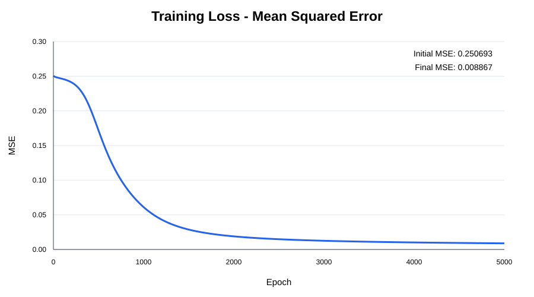
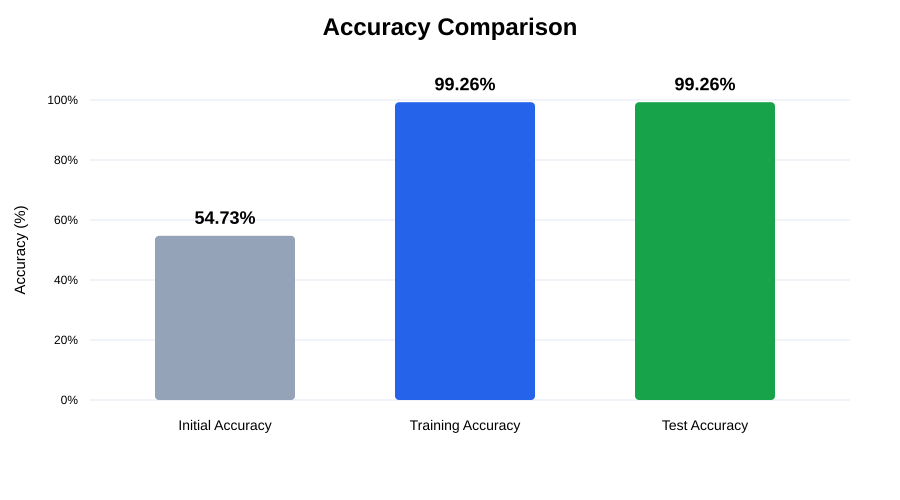
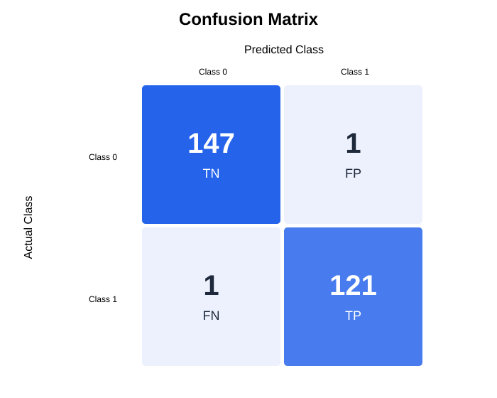
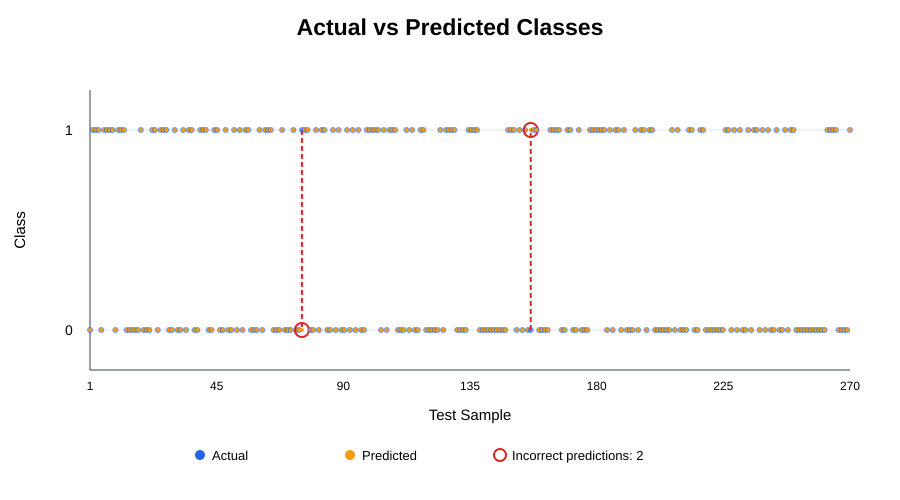

# Banknote Authentication — Neural Network from Scratch

A feedforward artificial neural network implemented from scratch using Python and NumPy for binary classification of banknotes.

The project demonstrates the mathematical foundations of neural networks, including forward propagation, backpropagation, sigmoid activation, mean squared error, and gradient descent, without relying on high-level machine learning frameworks.

## Project Objectives

- Implement an artificial neural network from scratch.
- Understand the mathematical foundations of neural network training.
- Perform data preprocessing using NumPy.
- Evaluate classification performance on unseen test data.
- Visualize training and classification results.
- Validate core software components through unit testing.

## Technologies

- Python
- NumPy
- SVG
- unittest
- Git and GitHub

NumPy is the only external Python dependency. No TensorFlow, PyTorch, Keras, Scikit-learn, Pandas, or Matplotlib is used.

## Dataset

The project uses the Banknote Authentication dataset from the UCI Machine Learning Repository.

Dataset source: https://archive.ics.uci.edu/dataset/267/banknote+authentication

| Property | Value |
|---|---:|
| Original records | 1372 |
| Removed duplicate records | 24 |
| Remaining records | 1348 |
| Input features | 4 |
| Target classes | 2 |
| Missing values | 0 |
| Training samples | 1078 |
| Test samples | 270 |

### Input Features

1. Variance of wavelet transformed image
2. Skewness of wavelet transformed image
3. Curtosis of wavelet transformed image
4. Entropy of image

The target variable contains two classes: 0 and 1.

## Data Preprocessing

The preprocessing pipeline consists of:

1. Loading the dataset.
2. Removing duplicate records.
3. Inspecting missing values and class distributions.
4. Separating input features and target labels.
5. Randomly splitting the dataset into training and test sets.
6. Checking for overlapping records and input features.
7. Standardizing features using training data statistics only.

A fixed random seed is used to support experiment reproducibility.

## Neural Network Architecture

The model uses a fully connected feedforward neural network with one hidden layer.

| Layer | Number of neurons | Activation |
|---|---:|---|
| Input | 4 | — |
| Hidden | 8 | Sigmoid |
| Output | 1 | Sigmoid |

Total trainable parameters: 49.

### Training Configuration

| Hyperparameter | Value |
|---|---|
| Learning rate | 0.1 |
| Epochs | 5000 |
| Loss function | Mean Squared Error |
| Optimization | Full-batch Gradient Descent |
| Classification threshold | 0.5 |
| Training ratio | 80% |
| Test ratio | 20% |
| Random seed | 42 |

## Mathematical Implementation

The neural network implements the following operations manually using NumPy:

- Weight and bias initialization
- Forward propagation
- Sigmoid activation
- Sigmoid derivative
- Mean squared error
- Backpropagation
- Gradient descent
- Binary classification

All trainable parameters are updated using manually calculated gradients.

## Experimental Results

| Metric | Result |
|---|---:|
| Initial training accuracy | 54.73% |
| Final training accuracy | 99.26% |
| Test accuracy | 99.26% |
| Precision | 99.18% |
| Recall | 99.18% |
| F1-score | 99.18% |
| Initial MSE | 0.250693 |
| Final training MSE | 0.008867 |
| Test MSE | 0.008587 |
| Training loss reduction | 96.46% |
| Correct test predictions | 268 / 270 |
| Incorrect test predictions | 2 / 270 |

The model achieved a test accuracy of 99.26% on the selected train-test split.

These results are based on a single reproducible train-test split and do not establish performance across all possible data distributions.

## Visualizations

### Training Loss



### Accuracy Comparison



### Confusion Matrix



### Actual vs Predicted Classes



All visualizations are generated directly in SVG format without external plotting libraries.

## Project Structure

- `data/` — Original dataset
- `results/` — Experimental results in CSV format
- `figures/` — Generated SVG visualizations
- `main.py` — Main experiment pipeline
- `data_preprocessing.py` — Data cleaning and preprocessing
- `neural_network.py` — Neural network implementation
- `evaluation.py` — Classification metrics
- `save_results.py` — Experimental result export
- `visualization.py` — SVG visualization generation
- `test_project.py` — Unit tests
- `requirements.txt` — External dependencies

## Installation

Clone the repository:

```bash
git clone https://github.com/kckaratass/numpy-neural-network.git
cd numpy-neural-network
```

Create a virtual environment:

```bash
python -m venv .venv
```

Activate the virtual environment on Windows:

```powershell
.\.venv\Scripts\Activate.ps1
```

Install dependencies:

```bash
pip install -r requirements.txt
```

## Usage

Train and evaluate the neural network:

```bash
python main.py
```

Generate visualizations:

```bash
python visualization.py
```

Run unit tests:

```bash
python -m unittest test_project -v
```

## Software Testing

The project includes 12 unit tests covering:

- Activation functions
- Loss calculation
- Neural network parameter dimensions
- Forward propagation
- Backpropagation
- Training loss reduction
- Prediction
- Data preprocessing
- Classification metrics

All 12 unit tests passed in the recorded test run.

## Conclusion

This project demonstrates how a feedforward neural network can be implemented, trained, and evaluated using NumPy without high-level machine learning frameworks.

The implementation provides an educational foundation for understanding neural network mathematics, optimization algorithms, data preprocessing, and classification performance evaluation.

## Author

**Kadir Can Karataş**

Computer Engineering Student

Bolu Abant İzzet Baysal University

GitHub: https://github.com/kckaratass

## Acknowledgments

UCI Machine Learning Repository — Banknote Authentication Dataset.

This project was developed for educational purposes as part of an Artificial Neural Networks course.